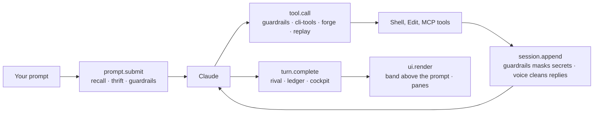

<!-- readme:header:start -->
<p>
  
  
</p>
<!-- readme:header:end -->

# claude-mods

> Ten Claude Code mods you install one at a time: guardrails, a model router, a slop filter, memory recall, a live pane and more.

<!-- readme:status:start -->
**Active**. I work on it this month.
<!-- readme:status:end -->



## Why

Most of what I want from Claude Code I used to write into `CLAUDE.md` and hope the model followed: don't force-push
without asking, don't print secrets, don't use Opus for a one-line question. A mod enforces it in the engine
instead. A mod is a Claude Code plugin whose hooks are one TypeScript module running inside the CLI: it can stop or
rewrite a tool call, edit what the model reads, draw a pane or a band above the prompt, call MCP servers and make its
own model requests.

## What it does

| Mod | What changes for you | Model calls |
|---|---|---|
| [guardrails](mods/guardrails) | Keeps work and personal tools apart, masks secrets in tool output, asks a second model before irreversible commands (force push, `rm -rf`, SQL drop), fixes common shell mistakes, stops retry loops, shows a diff budget | a fork per irreversible command; Haiku per prompt for the budget |
| [thrift](mods/thrift) | Tells you when a cheaper model would do, coaches and forecasts context use, `/diet` drops system-prompt sections you don't need | Haiku per prompt (router) |
| [voice](mods/voice) | Strips filler and AI tells from replies; flags claims that cite no file:line, command output or URL | Haiku per long answer |
| [recall](mods/recall) | Adds memories from your memory MCP server to each prompt, smarter @-mentions, turns repeated corrections into rules, `/verify` `/remember` `/why` on a selection | Haiku per prompt |
| [cockpit](mods/cockpit) | `/cockpit` pane with cost, context, git, PR checks and your own gauges; an inbox for messages from other sessions; a summary when you come back | optional Haiku summary |
| [cli-tools](mods/cli-tools) | Shell commands from your settings become typed tools the model sees from the first turn | none |
| [rival](mods/rival) | After a turn that changed files, a read-only reviewer looks for bugs in the diff and lists them above the prompt | one subagent review per changed turn |
| [forge](mods/forge) | Claude can propose a new mod; nothing is written until you approve it in a dialog | none |
| [ledger](mods/ledger) | Active hours per repo, `/hours`, CSV export, a monthly goal; drafts a post when a PR merges (never posts it) | one draft per merge, opt-in |
| [replay](mods/replay) | `/replay` steps through a session's file changes turn by turn | none |

Every personal value (hosts, MCP server names, paths) is a setting that defaults to off. Each mod's README lists its
settings and what it costs.

Not here: a sandbox. Mods run with your Claude Code session's access, so guardrails is a seatbelt against mistakes,
not a security boundary.

> [!WARNING]
> Read a mod before you install it. `claude plugin validate <folder>` lists every hook it registers and every call it makes.

## Quick start

Needs Claude Code 2.1.287 or newer. At the prompt of a terminal session:

```
/plugin install guardrails --marketplace Egoushka/claude-mods
```

From a shell:

```bash
claude plugin install guardrails --marketplace Egoushka/claude-mods
```

In the desktop app: click + next to the prompt box, then Plugins, Add marketplace with `Egoushka/claude-mods`, then
Add plugin. Swap `guardrails` for any mod above; settings show up in the config menu.

## How it works

Each mod is a folder under `mods/` listed in [.claude-plugin/marketplace.json](.claude-plugin/marketplace.json). Its
`hooks/register.tsx` subscribes to engine events (the boxes in the diagram) and either passes the event on, changes
it or refuses it. The band above the prompt is one shared surface: every mod adds its row to what the others drew and
never replaces it, so any set of mods can run together. `scripts/check.sh` type-checks, validates and tests every mod.

## Numbers

| | Value | Source |
|---|---|---|
| Mods | 10 | `.claude-plugin/marketplace.json` |
| Test cases | 151 in 11 files | `grep -c` over `mods/*/tests/*.test.ts`, 2026-10-20 |

## Docs

- Each mod's README (linked in the table): what it does, its settings, what it costs
- [CONTRIBUTING.md](CONTRIBUTING.md): how a mod is laid out and the rules learned writing these

<!-- readme:footer:start -->
---

<sub>Made by [Yehor Hrabovskyi](https://hrabovskyi.online) · [MIT licence](LICENSE).</sub>
<!-- readme:footer:end -->
